# STR and CoStar-Style Hotel Performance Report (2025)

End-to-end hospitality revenue and profitability benchmark across a 126-room portfolio (**City Hotel**, 60 rooms; **Resort Hotel**, 66 rooms) built from 15,500 reservations covering arrivals from 1 January to 31 December 2025. Evaluates rooms efficiency (**Occupancy, ADR, RevPAR**), booking lead times and pickup velocity, channel cancellation leakage, total revenue per available room (**TRevPAR**), and departmental profit flow-through (**GOPPAR**).

---

## Quick Navigation and Deliverables

Jump directly to any analytical deliverable or source file in this repository:

* **[Interactive KPI Report (PDF)](Hotel_KPI_Interactive_Report.pdf)** - 17-slide interactive visual report with executive findings, KPI formulas, and strategic recommendations.
* **[Interactive KPI Report (PowerPoint)](Hotel_KPI_Interactive_Report.pptx)** - Editable presentation deck for executive stakeholder reviews.
* **[Executive KPI Dashboard (PDF)](Hotel_KPI_Dashboard.pdf)** - High-level performance summary scorecard.
* **[Executive KPI Dashboard (PowerPoint)](Hotel_KPI_Dashboard.pptx)** - Editable summary dashboard slides.
* **[Python Analytical Notebook](_STR%20CoStar%20Style%20Performance%20Analyses.ipynb)** - Complete reproducible data pipeline, KPI calculations, and chart generation.
* **[2025 Booking Dataset (CSV)](Hotel_Dataset_2025.csv)** | **[Data Dictionary (CSV)](Hotel_Dataset_2025_Data_Dictionary.csv)** - Underlying reservation records and schema definitions.

---

## Portfolio Scorecard at a Glance

| KPI | City Hotel (60 Rooms) | Resort Hotel (66 Rooms) | Portfolio (126 Rooms) | Key Takeaway |
| :--- | :---: | :---: | :---: | :--- |
| **Occupancy** | 65.8% | 67.5% | **66.7%** | City peaks in Mar (80%); Resort peaks in Jul (89%) |
| **ADR** | EUR 113.5 | EUR 132.8 | **EUR 123.7** | Resort commands a EUR 19.3 rate premium |
| **RevPAR** | EUR 74.3 | EUR 89.4 | **EUR 82.2** | Resort leads RevPAR by 20% |
| **TRevPAR** | EUR 101.2 | EUR 153.0 | **EUR 128.3** | Ancillary spend adds EUR 46.1 per available room |
| **GOPPAR** | EUR 33.0 | EUR 39.3 | **EUR 36.3** | Portfolio GOP totals EUR 1.67M at a 28.3% margin |
| **Total Revenue** | EUR 2.22M | EUR 3.69M | **EUR 5.90M** | Rooms generate 64.1% of revenue; F&B adds 25.3% |

---

## 1. Rooms Performance and Room-Type Yield

Room revenue totals **EUR 3.78M** across the portfolio (Resort: EUR 2.15M, 57% share; City: EUR 1.63M). Demand follows opposite seasonal clocks: City Hotel peaks in spring and autumn (80% occupancy in March; 45% trough in December), while Resort Hotel surges in mid-summer (89% in July; 41% trough in January).

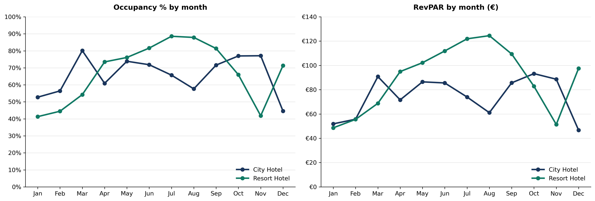

Across room categories, **Villa (Resort)** leads the portfolio at **EUR 197 RevPAR** (64% occupancy at EUR 311 ADR), followed by **Family Room (Resort)** at **EUR 115 RevPAR** (72% occupancy). At City Hotel, **Superior Rooms** achieve the highest occupancy (79%), whereas **City Suites** command the highest rate (EUR 240 ADR) at 41% occupancy (EUR 98 RevPAR).

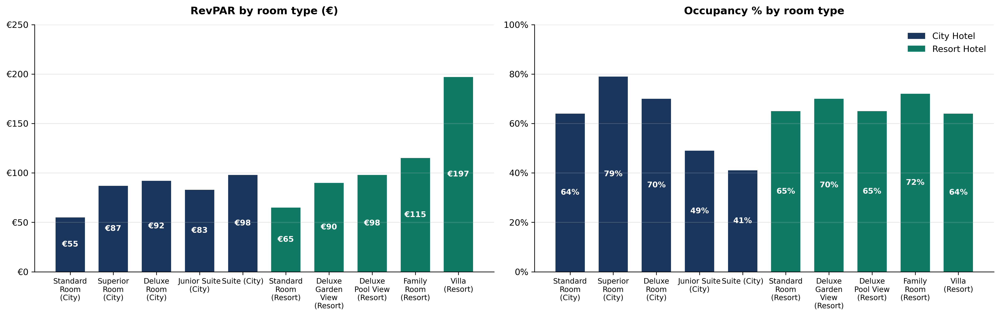

---

## 2. Booking Pace and Short-Term Pickup Velocity

Cumulative pace curves show that Resort Hotel builds its base earlier: **48%** of Resort room nights are on the books 60 days before arrival compared to **30%** at City Hotel (69% vs. 48% at 30 days out). Across market segments, **Groups** lock in earliest (58% booked 90 days out), while **Business Transient** books latest (44% booked inside 7 days).

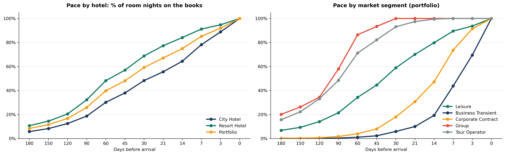

Because City Hotel relies heavily on short-lead demand, **24.2%** of its room nights are picked up in the final 7 days and **52.6%** within 30 days of arrival, compared to **9.7%** and **31.9%** at Resort Hotel.

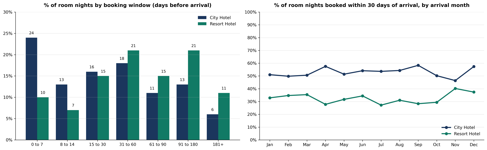

---

## 3. Market Segments, Distribution Channels, and Cancellation Leakage

Across all 15,500 reservations, **24.4%** of bookings cancel. **Leisure** generates 55.4% of room revenue at the highest segment ADR (EUR 138), yet experiences the highest segment cancellation rate (31.9%), whereas **Corporate Contract** cancels at just 9.6%.

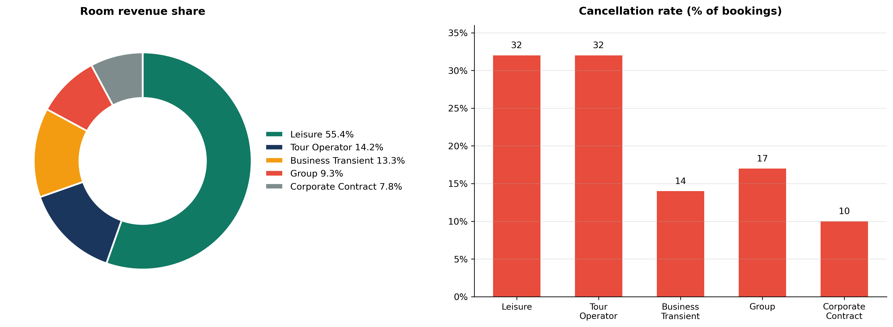

By distribution channel, **Online Travel Agencies (OTA)** deliver 25.0% of room revenue (EUR 136 ADR) but suffer a **37.8% cancellation rate**, compared to **21.9%** on the **Direct Website** (EUR 138 ADR) and **10.1%** via **Corporate Booking Tools**.

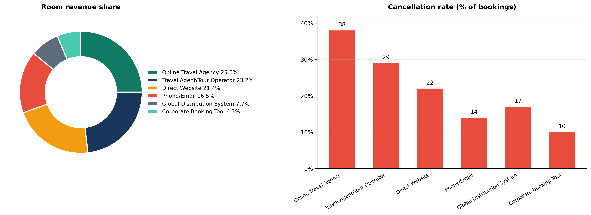

<details>
<summary><b>Click to expand full Market Segment and Channel Benchmark Tables</b></summary>
<br>

**Market Segment Performance**

| Segment | Room Nights Share | ADR | Median Lead Time | Cancellation Rate | Ancillary Share |
| :--- | :---: | :---: | :---: | :---: | :---: |
| **Leisure** | 49.6% | EUR 138 | 36 days | 31.9% | 36.7% |
| **Tour Operator** | 17.6% | EUR 100 | 88 days | 31.4% | 41.1% |
| **Business Transient** | 12.6% | EUR 130 | 5 days | 14.4% | 19.9% |
| **Group** | 11.3% | EUR 101 | 94 days | 16.9% | 47.3% |
| **Corporate Contract** | 8.6% | EUR 112 | 12 days | 9.6% | 23.8% |

**Distribution Channel Performance**

| Channel | Room Nights Share | ADR | Median Lead Time | Cancellation Rate | Ancillary Share |
| :--- | :---: | :---: | :---: | :---: | :---: |
| **Travel Agent / Tour Operator** | 25.7% | EUR 111 | 77 days | 29.0% | 40.4% |
| **Online Travel Agency (OTA)** | 22.7% | EUR 136 | 26 days | 37.8% | 35.6% |
| **Direct Website** | 19.2% | EUR 138 | 24 days | 21.9% | 34.3% |
| **Phone / Email** | 17.3% | EUR 117 | 58 days | 17.1% | 39.4% |
| **Global Distribution System (GDS)** | 8.2% | EUR 115 | 10 days | 14.0% | 27.8% |
| **Corporate Booking Tool** | 6.5% | EUR 119 | 10 days | 10.1% | 21.7% |

</details>

---

## 4. Total Hotel Revenue (TRevPAR) and Ancillary Mix

Non-room departments contribute **35.9%** of total portfolio revenue (EUR 69.1 per occupied room night). At Resort Hotel, ancillary revenue represents **41.6%** of total revenue (EUR 94.3 per occupied room night), lifting **Resort TRevPAR to EUR 153.0** (51% above City Hotel's EUR 101.2).

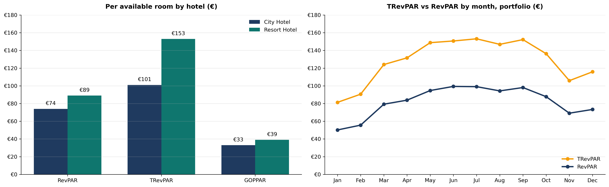

By segment, **Group** guests generate the highest ancillary share (**47.3%**), followed by **Tour Operator** (**41.1%**) and **Leisure** (**36.7%**).

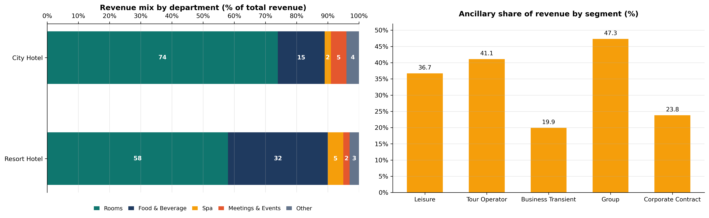

### Food and Beverage, Spa, and Meetings and Events
* **F&B and Spa Spend:** Resort guests spend nearly twice as much on Food and Beverage per guest night (**EUR 27.6** vs. **EUR 13.9** at City) and more on Spa (**EUR 4.4** vs. **EUR 2.4**), supported by 29.1% spa penetration and half-board/full-board meal plans.
* **Meetings and Events:** Generates **EUR 190k** across the portfolio (City: EUR 109k, 4.9% of revenue; Resort: EUR 81k, 2.2% of revenue), with **81% (EUR 154k)** driven by Group bookings and peaking in October (EUR 25k).

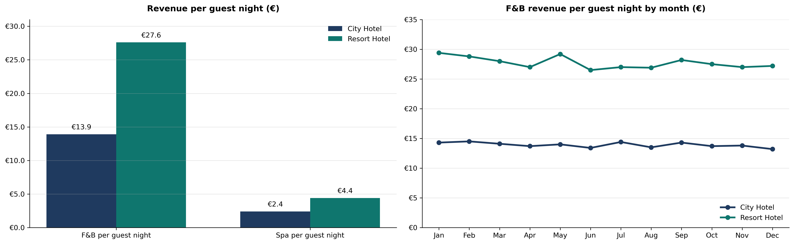

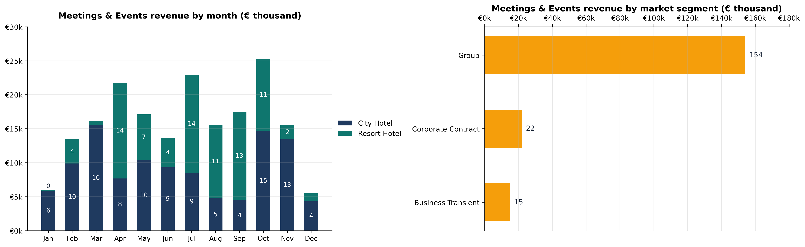

---

## 5. Departmental Profitability and GOP Flow-Through

Applying departmental flow-through margins (Rooms 72%, F&B 30%, Spa 35%, Meetings and Events 45%, Other 50%, and 30% undistributed operating expenses) yields **EUR 3.44M in departmental profit** and **EUR 1.67M in Gross Operating Profit (28.3% GOP margin)**.

* **Rooms Dominance:** Rooms accounts for **79.2%** of total departmental profit (EUR 2.72M across both properties).
* **Margin vs. Volume:** City Hotel achieves a stronger GOP margin (**32.6%** vs. **25.7%** at Resort) due to its higher rooms revenue mix (73% vs. 58%), while Resort Hotel delivers higher absolute GOP (**EUR 0.95M** vs. **EUR 0.72M**) and higher **GOPPAR** (**EUR 39.3** vs. **EUR 33.0**).

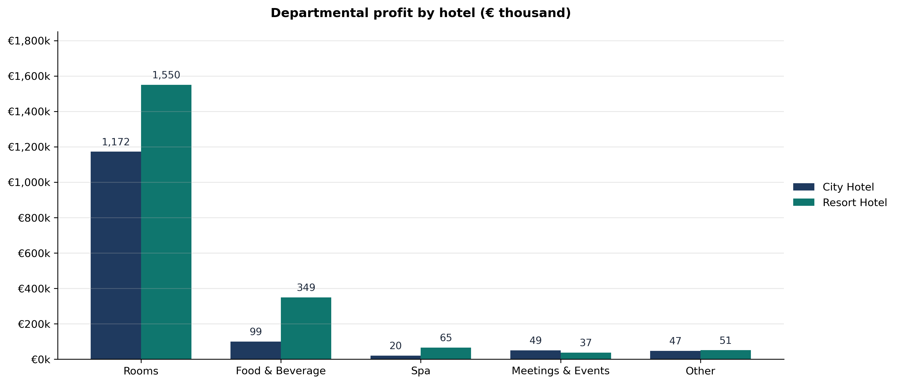

---

## Strategic Action Plan

1. **Defend Peak Resort Rates:** Enforce higher rate floors and minimum length-of-stay controls at Resort Hotel during July and August (88% to 89% occupancy).
2. **Stimulate City Winter Shoulder Demand:** Target corporate contracts and winter group blocks to lift City Hotel occupancy in December (45%) and January (53%).
3. **Curb OTA Cancellation Leakage:** Shift demand from high-cancellation OTAs (37.8%) toward Direct Website bookings (21.9%) and incentivize non-refundable advance-purchase rates (14.0% cancellation vs. 31.5% on flexible rates).
4. **Separate Group and Transient Pace Tracking:** Monitor Group pace independently at 90+ days out, as Groups represent 58% of 90-day base bookings and 81% of Meetings and Events revenue.
5. **Bundle City Ancillary Packages:** Package dining and spa credits into City Hotel leisure stays to narrow the F&B spend gap (EUR 13.9 vs. EUR 27.6 per guest night).

---

## Repository Structure

```text
├── Hotel_Dataset_2025.csv                               # Synthetic 2025 hotel booking dataset (15,500 bookings)
├── Hotel_Dataset_2025_Data_Dictionary.csv               # Column definitions, units, and KPI mapping
├── _STR CoStar Style Performance Analyses.ipynb         # Reproducible Python analysis and visualization notebook
├── Hotel_KPI_Interactive_Report.pdf                     # 17-page interactive KPI report
├── Hotel_KPI_Interactive_Report.pptx                    # Editable PowerPoint version of the interactive report
├── Hotel_KPI_Dashboard.pdf                              # Executive summary dashboard (PDF)
├── Hotel_KPI_Dashboard.pptx                             # Executive summary dashboard (PowerPoint)
└── images/                                              # High-resolution PNG charts (Chart_01 to Chart_11)
